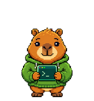
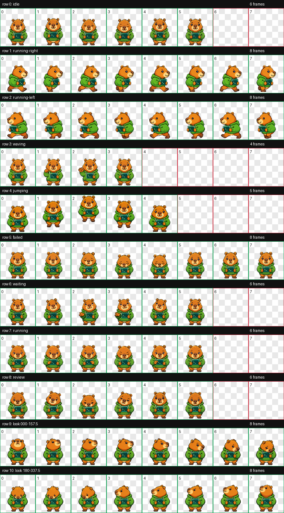
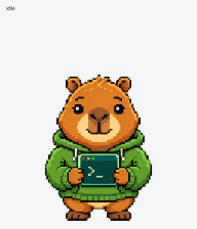
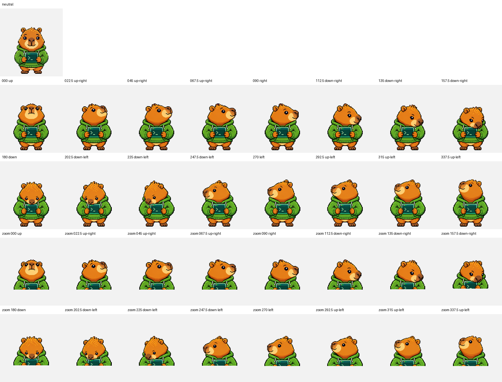

> Codex自动安装提示词：请将本地Pet-Kun文件夹中的“像素水豚”安装为Codex自定义宠物。读取pet.json，确认id为pixel-capybara、spriteVersionNumber为2、spritesheetPath为spritesheet.webp；把pet.json、spritesheet.webp和LICENSE复制到当前用户的`<CODEX_HOME>/pets/pixel-capybara/`，未配置CODEX_HOME时使用`~/.codex/pets/pixel-capybara/`。如果同名目录已经存在，先保留可恢复备份，再更新该目录。完成后告诉我如何在宠物选择器中选择“像素水豚”。

<div align="center">

<h1>Pet-Kun</h1>

<p>像素水豚·Codex v2动画宠物</p>

<p>一只穿着绿色披风、抱着小电脑的像素水豚，陪你认真工作，也会顽皮卖萌。</p>



<p>
  
  
  
  <a href="LICENSE"></a>
</p>

<p><a href="#项目概览">项目概览</a> · <a href="#预览">预览</a> · <a href="#快速开始">快速开始</a> · <a href="#手动安装">手动安装</a> · <a href="#技术规格">技术规格</a> · <a href="#质量验证">质量验证</a> · <a href="#许可">许可</a></p>

</div>

## 项目概览

Pet-Kun是面向Codex桌面应用的v2自定义动画宠物资源包。角色“像素水豚”采用像素画风，保留棕黄色身体、圆润口鼻、绿色披风和手持小电脑等外观特征。

本版本以现有宠物为身份参考，重新制作9组标准动作和16向注视，统一角色尺寸、脚底基线、图集格式与展示素材。运行资源由pet.json和spritesheet.webp组成。

本地安装ID为pixel-capybara，与云端宠物收藏记录分别管理。复制仓库文件用于本地安装，不会直接更新云端收藏中的图集。

## 核心能力

- 1536×2288的v2图集，8列×11行，单元尺寸192×208。
- 9组独立标准动作，共57帧，15个未使用单元保持透明。
- 16帧顺时针注视，躯干和电脑保持稳定，头部表达上下左右方向。
- 左右移动分别生成，保留小电脑屏幕图案的正常方向。
- 跳跃包含预备、腾空、顶点、下降和落地；等待、工作与评审各有可读姿态。
- 透明WebP/RGBA图集，采用无损编码。
- 提供静态状态表、逐状态GIF、注视循环、动作串联GIF和MP4。

## 预览

### 完整状态表

下图展示全部11行。绿色框表示运行使用的帧，红色框表示保持透明的未使用单元；标注仅存在于展示图中。

<p align="center">
  
</p>

### 动态预览

<p align="center">
  
</p>

[查看MP4动作预览](assets/animations/all-states.mp4) · [待机与跳跃衔接](assets/animations/idle-jump-idle.gif) · [查看关键动作静帧](assets/animations/motion-stills.png)

| 动作 | 预览 | 动作 | 预览 | 动作 | 预览 |
| --- | --- | --- | --- | --- | --- |
| 待机 | [idle](assets/animations/idle.gif) | 向右移动 | [running-right](assets/animations/running-right.gif) | 向左移动 | [running-left](assets/animations/running-left.gif) |
| 挥手 | [waving](assets/animations/waving.gif) | 跳跃 | [jumping](assets/animations/jumping.gif) | 失败反馈 | [failed](assets/animations/failed.gif) |
| 等待输入 | [waiting](assets/animations/waiting.gif) | 正在工作 | [running](assets/animations/running.gif) | 评审结果 | [review](assets/animations/review.gif) |

### 注视方向

方向采用屏幕坐标：000°向上、090°向右、180°向下、270°向左，以22.5°为一步顺时针排列。注视由头部和面部表达，双脚、躯干及电脑保持稳定。

<p align="center">
  
</p>

[查看16向注视循环](assets/animations/look-loop.gif)

## 动画状态

| 图集行 | 状态 | 有效帧数 | 应用语义 |
| ---: | --- | ---: | --- |
| 0 | `idle` | 6 | 待机、呼吸与眨眼 |
| 1 | `running-right` | 8 | 向屏幕右侧移动 |
| 2 | `running-left` | 8 | 向屏幕左侧移动 |
| 3 | `waving` | 4 | 挥手后回到持电脑姿态 |
| 4 | `jumping` | 5 | 预备、腾空、顶点、下降与落地 |
| 5 | `failed` | 8 | 沮丧、低头与恢复 |
| 6 | `waiting` | 6 | 期待用户输入、帮助或批准 |
| 7 | `running` | 6 | 操作电脑、认真处理任务 |
| 8 | `review` | 6 | 低头、眯眼并检查完成结果 |
| 9 | `look 000–157.5` | 8 | 注视方向前半圈 |
| 10 | `look 180–337.5` | 8 | 注视方向后半圈 |

待机行只使用前6个单元，不另设neutral帧。静止参考由正常待机姿态提供。

## 快速开始

使用支持v2自定义宠物图集的Codex桌面应用，先取得本仓库的本地文件夹，再把README开头的提示词发送给Codex，并指定Pet-Kun文件夹位置。

安装完成后，在应用的宠物选择器中选择“像素水豚”。如果列表没有刷新，可完全退出并重新打开应用后再查看。

```text
<CODEX_HOME>/pets/pixel-capybara/
├── pet.json
├── spritesheet.webp
└── LICENSE
```

仓库尚未配置Git远程地址，也未提供已核实的Release下载入口。自动安装提示词使用本地文件夹作为来源。

## 手动安装

### Windows/PowerShell

在已取得的Pet-Kun文件夹根目录执行：

```powershell
$codexBase = if ($env:CODEX_HOME) { $env:CODEX_HOME } else { Join-Path $env:USERPROFILE '.codex' }
$petDestination = Join-Path $codexBase 'pets/pixel-capybara'
if (Test-Path -LiteralPath $petDestination) {
    $petBackup = "$petDestination.backup-$(Get-Date -Format 'yyyyMMdd-HHmmssfff')"
    Copy-Item -LiteralPath $petDestination -Destination $petBackup -Recurse -ErrorAction Stop
}
New-Item -ItemType Directory -Force -Path $petDestination | Out-Null
Copy-Item -LiteralPath 'pet.json','spritesheet.webp','LICENSE' -Destination $petDestination -Force -ErrorAction Stop
```

### macOS/Linux

以下为目录复制命令，需在Pet-Kun根目录执行；本次未在macOS/Linux上实测应用加载。

```bash
PET_DEST="${CODEX_HOME:-$HOME/.codex}/pets/pixel-capybara"
if [ -d "$PET_DEST" ]; then
  PET_BACKUP="${PET_DEST}.backup-$(date +%Y%m%d-%H%M%S)"
  cp -R "$PET_DEST" "$PET_BACKUP" || exit 1
fi
mkdir -p "$PET_DEST" || exit 1
cp pet.json spritesheet.webp LICENSE "$PET_DEST/"
```

两种方式均复制运行清单、图集和LICENSE。assets与qa目录用于展示和记录，不参与宠物运行。

## 包结构与运行方式

Pet-Kun是已经组装完成的静态宠物包，不需要编译、安装依赖或运行构建脚本：

```text
pet.json ──────────身份、名称、协议版本与图集路径──┐
                                                ├──> Codex宠物运行时
spritesheet.webp ──8列×11行的透明动画图集────────┘
```

图集由统一角色参考、独立动作条带、四方向基准和两组注视条带组装而成，进行共享尺寸/基线注册及一次色键边缘清理。WebP是最终运行文件；PNG、GIF和MP4展示素材从最终图集生成。

本仓库提供运行包与展示/检查记录，原始生成条带和制作过程保留在制作工作目录中。仓库没有自动重新生成角色图像的构建流水线。

## 技术规格

| 项目 | 值 |
| --- | --- |
| 本地Pet ID | `pixel-capybara` |
| 显示名称 | 像素水豚 |
| 精灵图协议版本 | `2` |
| 图集格式 | WebP/RGBA，无损编码 |
| 图集尺寸 | 1536×2288 |
| 图集布局 | 8列×11行 |
| 单元尺寸 | 192×208 |
| 标准动画行 | 9 |
| 总有效帧数 | 73 |
| 未使用单元数 | 15 |
| 注视方向 | 16 |
| 注视角度间隔 | 22.5° |
| 背景 | 透明 |

pet.json内容如下：

```json
{
  "id": "pixel-capybara",
  "displayName": "像素水豚",
  "description": "一只穿着绿色披风、抱着小电脑的像素水豚，喜欢认真工作也会顽皮卖萌。",
  "spriteVersionNumber": 2,
  "spritesheetPath": "spritesheet.webp"
}
```

## 兼容性与项目状态

精灵图协议版本2表示资源布局，不是仓库Release版本号。项目未声明最低应用版本；运行端需支持对应的自定义宠物格式。

本次完成图集重制、文件检查和预览生成；未执行应用安装或跨平台运行测试。README结构参考Pet-Wei，角色介绍、安装ID、运行格式和验证说明按本项目实际内容编写。

## 质量验证

本次制作的检查范围包括：

- 9行标准动作逐行生成、组件提取及帧结构检查。
- 标准动作统一尺寸与基线，保留跳跃的垂直位移。
- v2尺寸、73帧有效单元、15个透明空单元及色键边缘检查。
- 四个基准注视方向与16向连续性检查。
- 独立方向盲评、跳跃离地/落地几何检查及最终质量门槛。
- 从最终WebP读取帧，生成各状态GIF、注视循环、待机/跳跃衔接、动作串联GIF和MP4。

四个基准方向通过独立盲评。202.5°帧的向左分量较弱，247.5°帧的俯仰幅度较轻，均作为中间方向的视觉提示保留记录；本项目不将生成姿态描述为经过精确角度测量。

具体结果和范围见[检查记录](qa/validation.json)及[16向语义记录](qa/direction-semantics.json)。检查记录中的warning表示需结合视觉判断的提示，不等同于应用运行故障，也不构成跨平台兼容性承诺。

## 仓库结构

```text
Pet-Kun/
├── README.md
├── LICENSE
├── pet.json
├── spritesheet.webp
├── assets/
│   ├── preview.png
│   ├── contact-sheet.png
│   ├── look-directions.png
│   └── animations/
│       ├── idle.gif、running-right.gif、running-left.gif
│       ├── waving.gif、jumping.gif、failed.gif
│       ├── waiting.gif、running.gif、review.gif
│       ├── look-loop.gif
│       ├── idle-jump-idle.gif
│       ├── all-states.gif
│       ├── all-states.mp4
│       └── motion-stills.png
└── qa/
    ├── validation.json
    └── direction-semantics.json
```

## 隐私与运行内容

宠物运行资源仅包含JSON清单和WebP图集，没有随包提供可执行程序、账号登录或网络请求脚本。README的Shields徽章在浏览项目页时由外部服务加载，安装宠物不依赖这些徽章。

## 贡献与支持

反馈安装问题时，请提供应用版本、操作系统和具体表现。修改图集时，请保持8列×11行布局、有效帧数和透明空单元，并同步更新pet.json引用、展示图片、动态预览和相关检查记录。

## 许可

本项目原创内容与Pet-Wei采用相同的[GNU General Public License v3.0](LICENSE)（`GPL-3.0-only`，仅第3版）发布。Copyright © 2026 Roylyl。第三方内容保留各自的版权与许可声明。

角色图像、宠物配置和随附文档均按仓库许可证提供；再分发时附带LICENSE并保留版权声明。本仓库的LICENSE文本原样复制自Pet-Wei。
